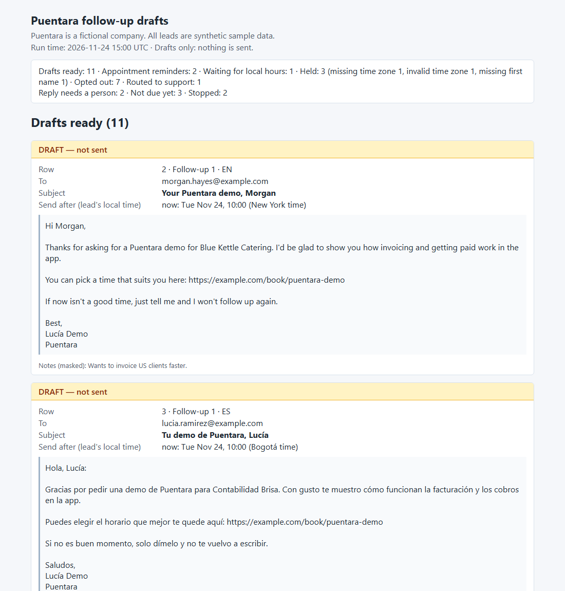

# Bilingual lead follow-up (EN/ES) for Google Sheets

Prepares follow-up and appointment-reminder email drafts in English and Spanish from a Google Sheet of sales leads, so a small sales team never forgets a follow-up, and a person still reviews and sends every message.

> Demo scenario. Puentara is a fictional company. All leads, names, emails (`@example.com`) and phone numbers (`+1-555-01XX`) are synthetic sample data made by a seeded script.



*`output/drafts.html` after `npm run demo`: the run summary, then each draft (here one in English and one in Spanish) with To, Subject, "Send after (lead's local time)" and a "DRAFT — not sent" banner. Sample data.*

## The problem

A small sales team keeps demo requests in a Google Sheet. Follow-ups depend on someone remembering, so leads go cold. Reps rewrite the same message in English and Spanish every day. Sometimes someone writes to a person who asked not to be contacted, or emails a lead at 6 a.m. their time. Each of these loses a lead or earns a complaint.

## What it does

- **Daily follow-up queue.** Reads the Leads sheet (or a CSV for the local demo). Follow-up 1 is due 1 business day after the demo request, follow-up 2 three business days after that, and a final "closing the loop" message seven business days later. Then it stops. The day counts and the local hours are settings on a Config tab.
- **Stops for good** when Status is Replied, Booked (reminders only), Closed or Do not contact. A lead with a reply is shown as "Reply needs a person". A reply never triggers an automatic follow-up.
- **English and Spanish templates** for 3 follow-ups, a "let's talk on a call" message for pricing or approval questions, and an appointment reminder. Spanish uses tú. The language comes from the Language column. If that is blank, it guesses from the notes and reply and flags it ("check language").
- **Drafts only.** In Google Sheets it creates Gmail drafts (`GmailApp.createDraft`). With `DRY_RUN` on (the default), it only writes a "Draft preview" tab. The code has no send call, and a test fails the build if one appears.
- **Appointment reminders.** A Booked lead with an appointment gets one reminder draft the business day before, with the time written for the lead: "Wednesday, November 25 at 10:00 AM (New York time)" or "miércoles 25 de noviembre, 3:30 p. m. (hora de Bogotá)".
- **Lead's local hours.** Each draft has a "Send after" time inside the lead's own business hours (Mon–Fri 09:00–18:00 by default). Leads outside that window wait for a later run.
- **Safety checks before any draft** (see [Safety rules](#safety-rules-it-follows)).
- **Write-back and summary.** Updates Touches, Last drafted, Next due and Reminder drafted. Running twice on the same day creates no duplicates. Queue, Summary and Suppression tabs show what happened and why.
- **Bilingual sheet.** Column headers, tab names, the menu, queue reasons and the terminal summary all work in English or Spanish.

## Quick start (local demo, no Google account)

Prerequisites: [Node.js](https://nodejs.org/) 22.12 or newer and Git. No API key and no `.env` are needed: there is no AI step. (`.env.example` only says so.)

On Windows, clone into a short path such as `C:\dev\`. The commands below are the same in PowerShell (including Windows PowerShell 5.1) and bash. Run them one line at a time.

```
git clone https://github.com/RawBud11/bilingual-lead-followup.git bilingual-lead-followup
cd bilingual-lead-followup
npm install
npm test
npm run demo
npm run demo -- --lang es
npm run eval
```

- `npm test` runs 307 tests (vitest).
- `npm run demo` uses a fixed clock, **Tuesday 2026-11-24 15:00 UTC** (10:00 in New York and Bogotá, 07:00 in Los Angeles). It writes `output/queue.csv`, `output/drafts.html`, `output/leads_after_run.csv` (what the write-back would change) and `output/suppression.csv`.
- `--lang es` switches the terminal summary and page labels to Spanish. Each draft stays in its lead's language.
- `--now "2026-11-24 13:00"` sets another run time (UTC).

Open the draft preview page:

| PowerShell | bash (macOS / Linux) |
|---|---|
| `Start-Process output\drafts.html` | `open output/drafts.html` (macOS) or `xdg-open output/drafts.html` (Linux) |

If accents look wrong in Windows PowerShell, or before piping output to another command, run this first:

```powershell
[Console]::OutputEncoding = [Text.Encoding]::UTF8
npm run demo | Select-String "Held"
```

## Example output (captured, sample data)

`npm run demo`:

```
Puentara lead follow-up (Puentara is a fictional company; all data is synthetic sample data)
Drafts only: nothing is sent.
Run time: 2026-11-24 15:00 UTC

Drafts ready: 11 · Appointment reminders: 2 · Waiting for local hours: 1 · Held: 3 (missing time zone 1, invalid time zone 1, missing first name 1) · Opted out: 7 · Routed to support: 1
Reply needs a person: 2 · Not due yet: 3 · Stopped: 2

Drafts ready (11), each in the lead's language:
   2  EN  morgan.hayes@example.com        Follow-up 1                  now: Tue Nov 24, 10:00 (New York time)
   3  ES  lucia.ramirez@example.com       Follow-up 1                  now: Tue Nov 24, 10:00 (Bogotá time)
   4  EN  rowan.price@example.com         Follow-up 2                  now: Tue Nov 24, 09:00 (Chicago time)
   ...
  14  EN  cameron.holt@example.com        Questions: defer to a call   now: Tue Nov 24, 10:00 (New York time)  [needs rep]
  15  ES  nicolas.acosta@example.com      Questions: defer to a call   now: Tue Nov 24, 09:00 (Mexico City time)  [needs rep]
  33  EN  parker.gray@example.com         Follow-up 1                  now: Tue Nov 24, 10:00 (New York time)

Appointment reminders (2):
  26  EN  avery.collins@example.com       Appointment reminder         now: Tue Nov 24, 10:00 (New York time)
  27  ES  daniela.suarez@example.com      Appointment reminder         now: Tue Nov 24, 10:00 (Bogotá time)

Waiting for the lead's local hours (1), not drafted yet:
   8  EN  peyton.ford@example.com         Follow-up 1                  next window: Tue Nov 24, 09:00 (Los Angeles time)
```

`npm run demo -- --lang es`:

```
Seguimiento de prospectos de Puentara (Puentara es una empresa ficticia; todos los datos son de muestra, sintéticos)
Solo borradores: no se envía nada.
Hora de ejecución: 2026-11-24 15:00 UTC

Borradores listos: 11 · Recordatorios de cita: 2 · Esperan el horario local: 1 · En espera: 3 (falta zona horaria 1, zona horaria no válida 1, falta nombre 1) · Dados de baja: 7 · Pasados a soporte: 1
Respuestas que necesitan a una persona: 2 · Aún no toca: 3 · Detenidos: 2

Borradores listos (11), cada uno en el idioma del prospecto:
   2  EN  morgan.hayes@example.com        Seguimiento 1                ahora: mar 24 nov, 10:00 (hora de Nueva York)
   3  ES  lucia.ramirez@example.com       Seguimiento 1                ahora: mar 24 nov, 10:00 (hora de Bogotá)
   ...
  15  ES  nicolas.acosta@example.com      Preguntas: dejarlas para la llamada  ahora: mar 24 nov, 09:00 (hora de Ciudad de México)  [necesita al asesor]
```

A Spanish draft from `output/drafts.html` (row 3):

```
Asunto: Tu demo de Puentara, Lucía
Enviar después de (hora local del prospecto): ahora: mar 24 nov, 10:00 (hora de Bogotá)

Hola, Lucía:

Gracias por pedir una demo de Puentara para Contabilidad Brisa. Con gusto te muestro cómo funcionan la facturación y los cobros en la app.

Puedes elegir el horario que mejor te quede aquí: https://example.com/book/puentara-demo

Si no es buen momento, solo dímelo y no te vuelvo a escribir.

Saludos,
Lucía Demo
Puentara
```

Some rows from `output/queue.csv`, showing why a lead got no draft:

| Row | Action | Reason |
|---|---|---|
| 11 | Held | missing time zone |
| 12 | Held | invalid time zone "Hora del Este" (never guessed) |
| 16 | Route to support | notes say "Perdí mi tarjeta, alguien la está usando." (lost or stolen card) |
| 19 | Opted out | last reply says "remove me" |
| 24 | Opted out | same email as row 19, which is on the suppression list |
| 25 | Opted out | Booked, but the last reply says "unsubscribe": no reminder |
| 33 | Drafted | notes show `[CARD NUMBER MASKED]` and `[CODE MASKED]`; notes never go into a message |

`npm run eval` checks the opt-out detector on hand-written replies:

```
Opt-out detector check (sample data: synthetic, hand-written replies)
Replies: 55 (31 opt-outs, 24 other replies)
Opt-outs caught: 31 of 31
  EN: caught 15 of 15; false alarms 3 of 12
  ES: caught 16 of 16; false alarms 2 of 12
False alarms (would be blocked, a rep can check): 5
  R24 EN  "Can we stop by your office on Friday?"  (matched "stop")
  R25 EN  "Not interested in team cards, but invoicing yes."  (matched "not interested")
  R34 ES  "No me llamen antes de las 10, por favor."  (matched "no me llamen")
  R52 EN  "Can you add my partner to your mailing list?"  (matched "mailing list")
  R55 ES  "No me envíen el PDF, mejor el enlace."  (matched "no me envíen")
```

Read 31 of 31 with care: this is a small synthetic set, and it includes the phrases the keyword list was built from. It does not mean every real opt-out will be caught. The 5 false alarms are on purpose: the tool blocks too much rather than too little.

## Use it in a Google Sheet (Apps Script)

> **Not tested in a live Google Sheet yet.** The Apps Script layer has only run against fakes of Google's services in `tests/apps-script.test.js`. The time-zone code (`Intl.DateTimeFormat`) has only run in Node, so Apps Script V8 behaviour is untested. The hourly trigger has only been tested against fakes. Try it on a copy of your sheet first.

It never sends email. With `DRY_RUN = false` it creates Gmail **drafts** only, and only for leads whose local hours are open at that moment. A person opens Gmail, reviews each draft and sends it.

1. Open a Google Sheet you own. Go to **Extensions > Apps Script**.
2. Replace everything in the editor's `Code.gs` with the whole of [`dist/Code.gs`](dist/Code.gs) from this repo. Save. (`dist/Code.gs` is built from `src/` and `apps-script/Code.gs` by `npm run bundle`.) To get Spanish tabs and menu, set `SETUP_LANGUAGE = "es"` near the top before the next step.
3. Check **File > Settings > Time zone** in the sheet. It decides which day counts as "today".
4. Reload the sheet. A **Lead follow-up** menu appears (Spanish: **Seguimiento de prospectos**).
5. Click **Set up tabs**. It creates Leads, Config, Queue, Draft preview, Summary and Suppression. Optionally click **Load sample data** (synthetic leads, only into an empty Leads tab; their dates are around 2026-11-24, so on other days more of them are due at once).
6. Leave `DRY_RUN = true` (the default). Click **Prepare today's drafts**. Google asks for permission the first time. Check the Queue, Draft preview and Summary tabs. In DRY_RUN the Leads tab is not changed (opt-outs are still added to the Suppression tab, since that is a safety list).
7. Once, in the Apps Script editor, select **`checkTimeZoneSupport`** and click **Run**. Open the execution log. Every line should start with `OK`. If a line says `DIFF`, do not use the tool for that time zone.
8. When the preview looks right, set `DRY_RUN = false` and save. Now each run creates Gmail drafts and writes back Touches, Last drafted, Next due and Reminder drafted.
9. Click **Run every hour** (`installHourlyTrigger`). Each hourly run drafts only what is due and inside each lead's local hours. A lock stops a menu click and the trigger from running at the same time, and "Last drafted" stops the same draft being made twice.

**Columns** (English or Spanish headers both work): First name, Company, Email, Phone, Language, Time zone, Interest, Rep name, Requested on, Status, Opt-out, Touches, Last drafted, Next due, Appointment, Reminder drafted, Notes, Last reply. Time zone must be an IANA name such as `America/New_York` or `America/Bogota`. `EST` or "Hora del Este" is held, not guessed. Replies are not read from Gmail: a rep pastes the lead's latest reply into Last reply.

## How it works

All the rules live in plain JavaScript files in `src/` that run both in Node (for tests and the demo) and in Apps Script: `followup.js` decides what happens to each lead, `optout.js` checks opt-outs and the suppression list, `hours.js` works out the lead's local time, `templates.js` fills and checks the messages, and `report.js` builds the queue, summary and write-back. `apps-script/Code.gs` is a thin layer that reads the sheet, creates drafts and writes results. For each lead the checks run in this order: opt-out (Status, Opt-out column, Last reply, Notes, suppression list), then support issues, then any reply (goes to a person), then unknown status, closed or finished sequence, then a missing or invalid time zone. Only then does it fill a template and check the lead's local hours.

## Safety rules it follows

- **Never sends.** Only `GmailApp.createDraft` is called. A test reads every source file and fails on `sendEmail`, `MailApp`, `GmailApp.send` or `.send(`. `DRY_RUN` defaults to on.
- **Opt-outs win.** Status "Do not contact" / "No contactar", the Opt-out column, or phrases like "unsubscribe", "remove me", "darme de baja" or "no me escriban" (accents and capitals ignored) stop all messages, even for a Booked lead. The email and phone go on the Suppression tab, so a second row for the same person is blocked too.
- **Every reply goes to a person.** Any Last reply that is not an opt-out makes the lead "Reply needs a person", whatever the Status, until a rep clears Last reply or changes the Status.
- **Lead's local hours.** Drafts carry a "Send after" inside the lead's window. A missing or invalid time zone holds the lead.
- **Support issues go to support, not sales.** Notes or replies that look like a lost or stolen card, fraud, account access or a failed transfer ("me robaron la tarjeta", "can't log in") get no sales draft. The queue says "Route to support".
- **No promises and no advice.** A check over every template fails the build on words like "guaranteed", "approved", "no fees", "garantizado", "sin comisiones", and on tax, legal or investment advice. A lead asking about price or approval gets a message that moves the answer to a call, flagged "Needs rep".
- **Never asks for sensitive data.** The same check bans asking for a card number, PIN, CVV, password or code ("número de tarjeta", "contraseña", "código"). Card numbers and codes in notes are masked in the queue and preview. Notes are never pasted into a message.
- **Missing data holds the lead.** A missing first name or other placeholder value holds the row with a reason. No "Hi {{first_name}}" ever reaches a draft.

The 09:00–18:00, Monday–Friday window is a sensible default, not legal advice. It is not a compliance feature, and this project makes no claim about TCPA, CAN-SPAM or any other law. Each business checks the rules that apply to it.

## Limits

- **The opt-out check is a keyword list. It will miss some wordings.** 31 of 31 in `npm run eval` applies only to its own small synthetic set, which includes the phrases the list was built from. That is why every reply goes to a person.
- **Support routing is a keyword list too.** Some fraud wordings are missed, for example "Me sacaron plata de la cuenta sin permiso" or "There is money missing from my account". A rep still reads the queue.
- **Notes are checked by keyword only.** Common third-person notes are caught ("Dijo que no le interesa", "Pidió que lo saquen de la lista", "Me pidió no volver a llamarlo", "asked us not to call"), but other wordings will slip through, and Notes have no "reply needs a person" backstop. **Reps should record phone opt-outs in the Opt-out column or set Status to "Do not contact"**, not only in Notes.
- **It leans toward over-blocking.** "Can we stop by…?", "add me to your mailing list", "No me llamen antes de las 10" and "No thanks" are treated as opt-outs (5 false alarms in the labeled set). A rep's note like "do not call before 10" also blocks the lead. A rep can check and undo these.
- **Booked + reply:** a Booked lead with any Last reply that is not an opt-out (for example "Great, see you Wednesday") gets no reminder until a rep clears Last reply. Safe, but a rep has to do it.
- **A reply that opts out and reports a problem** ("Unsubscribe me, and also someone stole my card") is marked only as opted out, not also routed to support.
- **Pricing-question leads** get the same "let's talk on a call" message on each follow-up, not the final message.
- **Not tested in a live Google Sheet.** Apps Script V8 time-zone behaviour is untested (run `checkTimeZoneSupport`). The hourly trigger has only been tested against fakes.
- Business days are Monday to Friday. There are no holiday calendars.
- One booking link for everyone (`https://example.com/book/puentara-demo` in the demo) and one Rep name per row.

## Ideas for next steps

- Read replies from Gmail automatically instead of pasting them into Last reply.
- Add the missed opt-out and fraud wordings above, and flag "opted out + support issue" as both.
- Holiday calendars for the US, Colombia, Mexico and Peru.
- Per-rep booking links and signatures.
- Connect the same `src/` logic to a CRM such as HubSpot instead of a sheet.

## Project layout

```
src/            the rules (plain JavaScript, runs in Node and Apps Script)
apps-script/    Code.gs: menu, sheet read/write, Gmail drafts, trigger
dist/Code.gs    one file to paste into Apps Script (npm run bundle)
scripts/        demo, eval, seed (sample data) and bundle
data/           leads.csv and optout_labeled.csv (synthetic, from scripts/seed.js)
tests/          vitest tests, including a fake of Google's services
docs/           screenshot and captured demo output
```

## Sample data

Puentara is a fictional company. Every lead, company name, email and phone number is synthetic, made by `scripts/seed.js` with a fixed seed (`npm run seed` rebuilds the same files). No real customer data is used.

## How this was built

Built with AI-assisted development tools; I planned, reviewed and tested it.

## License

MIT. See [LICENSE](LICENSE).
